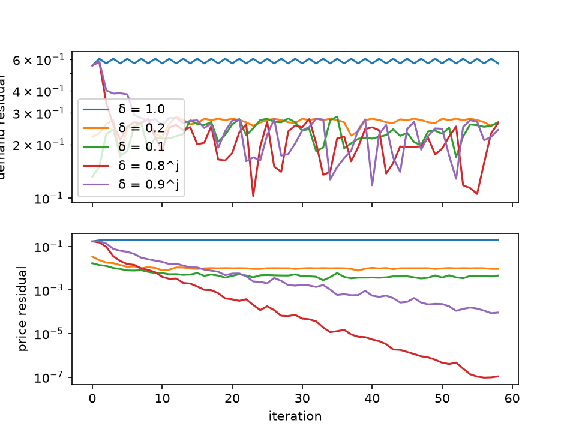
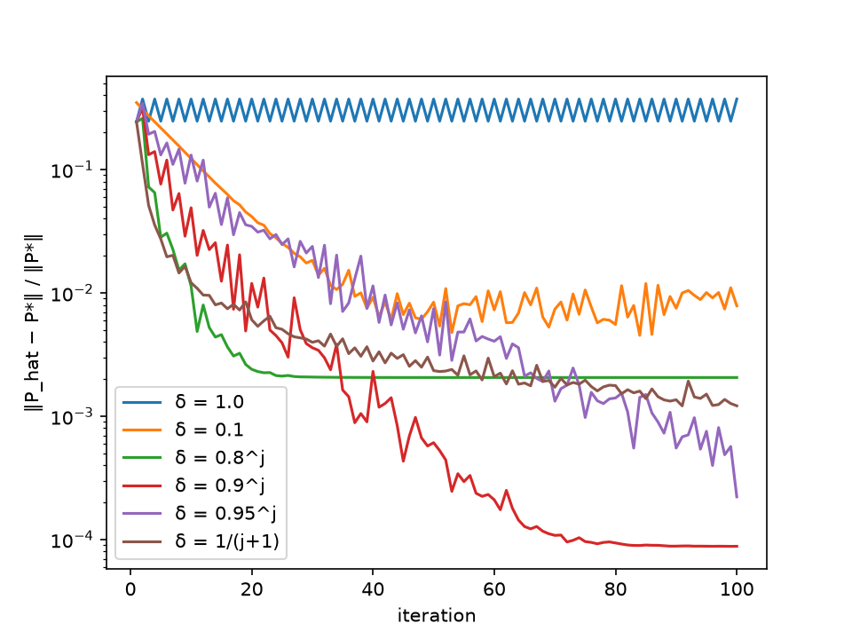

# h2-toy

A toy reproduction of the plant–grid iteration in

> C. Tsay & S. Qvist, *Integrating process and power grid models for optimal design and demand response operation of giga-scale green hydrogen*, AIChE Journal 69 (2023) e18268. https://doi.org/10.1002/aic.18268

The paper designs a ~10 GW hydrogen plant whose demand is large enough to move electricity prices, then links the plant model to a grid model (GenX) through an iterative price/demand exchange with a damped step size (§3.2, eq. 37–38). It notes that the scheme can oscillate, chooses a decaying step by inspection, and that equilibrium comes with no guarantees.

This repo builds a deliberately small version of that setup in which the **true equilibrium can be computed directly**, so each step-size rule can be measured against it.

## Model

**Plant** (simplified from §2): one day at hourly resolution; electrolyser (eq. 5, 7), hydrogen storage balance (eq. 9) with an end-empty condition, ramp limit of 20% of capacity per hour (eq. 8), flexibility cap of 1.5× the flat-out size (eq. 36), and a constant 150 t/h demand from the downstream steel plant (eq. 35). Electrolyser and storage size are decision variables with daily capital costs (simplified eq. 30). Heater, compressor, fuel cell, conversion losses and degradation are omitted; they don't change the decisions in this toy. The plant model is an LP.

**Grid**: instead of GenX, a fixed linear supply curve

    price[t] = B · (base[t] + P[t])

with `base` chosen so that a flat plant sees £30 (night), £50 (day) and £80 (evening peak).

## Steps

| Step | File | What it does |
|---|---|---|
| 1 | `plant.py` | Operate a plant with fixed capacities at fixed prices |
| 2 | `design.py` | Choose electrolyser and storage size as well (`build_plant`, `solve_plant`) |
| 3 | `grid.py`, `price_setter.py` | Price taker vs price setter (§3.1) |
| 4 | `iterate.py` | The paper's iterative scheme with constant and decaying step sizes |
| 5 | `equilibrium.py` | The true equilibrium, solved directly as one convex QP |
| 6 | `benchmark.py` | Distance from each rule's demand estimate to the true equilibrium |

## Results

**Steps 1–2.** With fixed equipment, shifting demand into cheap hours saves 8% (£8.265m vs £9.0m for a flat run). When the plant also chooses its size, it builds the maximum electrolyser (11,250 MW) and 960 t of storage (£8.388m vs £9.3m). Storage is worth building while the price spread it captures (× 50 MWh/t) exceeds its cost; above £2,500/t/day it builds none.

**Step 3: price setter.** Designing on flat-demand prices predicts £8.388m, but once the grid prices the plant's actual demand the same design costs **£9.333m, worse than not being flexible (£9.3m)**. The plant's buying raises prices in exactly the hours it buys (night and day +£7.5) and lowers them where it buys nothing (peak −£15), shrinking the spread it was sized for.
This is the opposite of the paper's price-setter result, because GenX re-plans grid *investment* around the flexible load, while this toy's supply curve is fixed (short run vs long run).

**Step 4: iteration.** Constant δ = 1 oscillates between two answers indefinitely (cf. Fig. 8). Damped rules settle the price residual, but the **demand residual stays around 0.2–0.26** for every rule (cf. the "less stable" demand in Fig. 9).



**Step 5: direct equilibrium.** Replacing the plant's electricity cost with the area under the supply curve,

    Σₜ [ B·base[t]·P[t] + (B/2)·P[t]² ]

gives a convex QP whose optimality conditions are exactly "the plant is optimal at the prices its own demand creates". Result: CAP* = 11,250 MW, SMAX* = 600 t, flat at 8,250 MW in hours 7–14 where every price equals £51.50.

At those prices, P\* costs the same as the plant's own LP optimum (within £2), **but the LP returns a different, zigzagging schedule**. At equilibrium the plant is indifferent between many schedules, and the equilibrium is a blend that an LP solver, which returns extreme solutions, never outputs.

**Step 6: benchmark.** Relative distance ‖P̂ − P\*‖ / ‖P\*‖ of the grid's demand estimate after each iteration:

| Rule | iter 10 | 25 | 50 | 100 |
|---|---|---|---|---|
| δ = 1.0 | 0.373 | 0.247 | 0.373 | 0.373 |
| δ = 0.1 | 0.123 | 0.025 | 0.008 | 0.008 |
| δ = 0.8^j | 0.011 | 0.002 | 0.002 | 0.002 |
| δ = 0.9^j | 0.049 | 0.004 | 0.0006 | **0.0001** |
| δ = 0.95^j | 0.131 | 0.025 | 0.008 | 0.0002 |
| δ = 1/(j+1) | 0.012 | 0.005 | 0.002 | 0.001 |



## Takeaways

1. **The demand residual measures the wrong thing for an LP plant.** With δ = 0.9^j the plant's last answer is still 12% from the estimate, yet the estimate is within 0.01% of the true equilibrium. The plant's answer jumps between equally optimal schedules; the right check is whether the estimate is *an* optimal schedule at its prices (step 5's cost comparison).
2. **Undamped iteration cannot converge here.** With δ = 1 the estimate is always one of the plant's extreme LP solutions, and the equilibrium is a blend of them. Damping averages past answers, which is what makes blends reachable.
3. **Decay rate trades speed for accuracy.** 0.8^j is fastest early but freezes 0.2% away, because the steps sum to a finite amount and run out before arriving. 0.9^j (the paper's choice) is best at 100 iterations in this instance.
4. **In this convex toy, the scheme is the Frank–Wolfe method.** The gradient of the step-5 QP with respect to P is `grid_price(P̂)`, the plant LP is the linear-minimisation step over the same feasible set, and eq. 37 is the Frank–Wolfe update. Standard convergence results need step sizes with Σδ = ∞ and δ → 0 (e.g. 1/(j+1) or 2/(j+2)), which geometric decay violates; that is consistent with 0.8^j stalling.

## Limitations

- Fixed supply curve: no capacity expansion, so it captures only the short-run price effect, not the grid investment response that drives the paper's price-setter results.
- One day, made-up prices and costs, and a plant that dominates the grid by construction.
- The plant model is an LP and the grid curve is linear, so the equilibrium is unique and computable. The paper's setting (bilinear storage constraint, GenX with integer decisions) is nonconvex, so takeaways 3–4 do not carry over directly; whether the oscillation and the sensitivity anomaly in §3.3.2 come from those non-convexities is an open question here.

## Running

```bash
python3 -m venv .venv && source .venv/bin/activate
pip install -r requirements.txt
python design.py        # step 2
python price_setter.py  # step 3
python iterate.py       # step 4, writes figures/residuals.png
python equilibrium.py   # step 5
python benchmark.py     # step 6, writes figures/distance_to_equilibrium.png
```

The plant LP uses HiGHS via `appsi_highs`; the equilibrium QP uses `highs`, since the appsi interface does not accept quadratic objectives.
